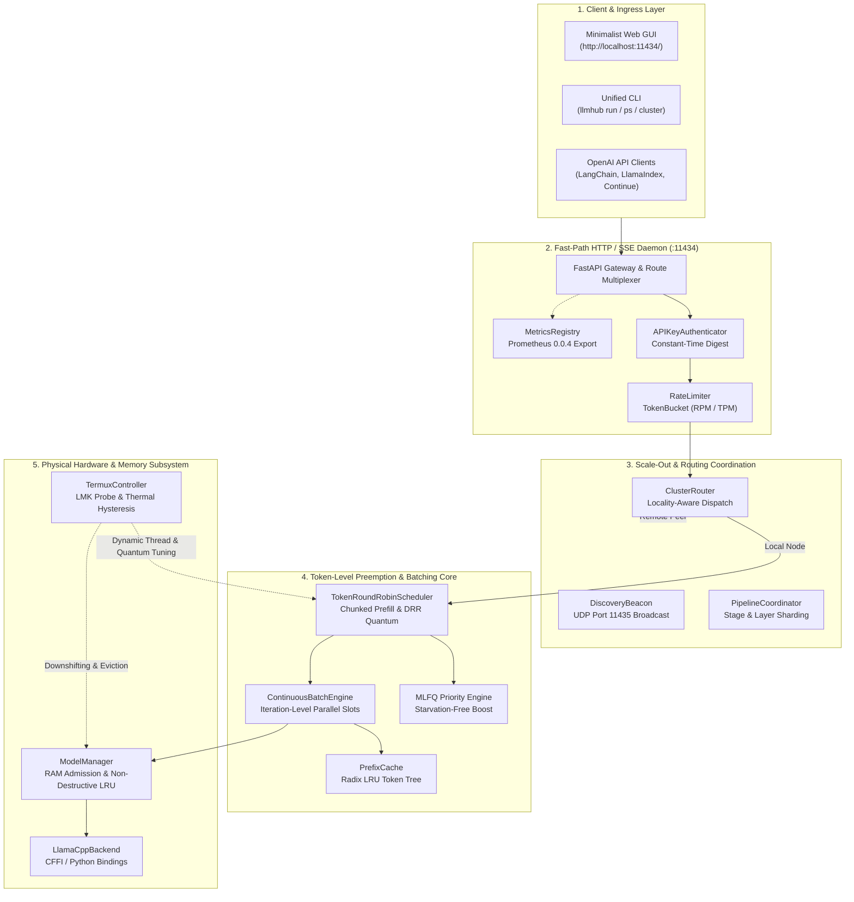
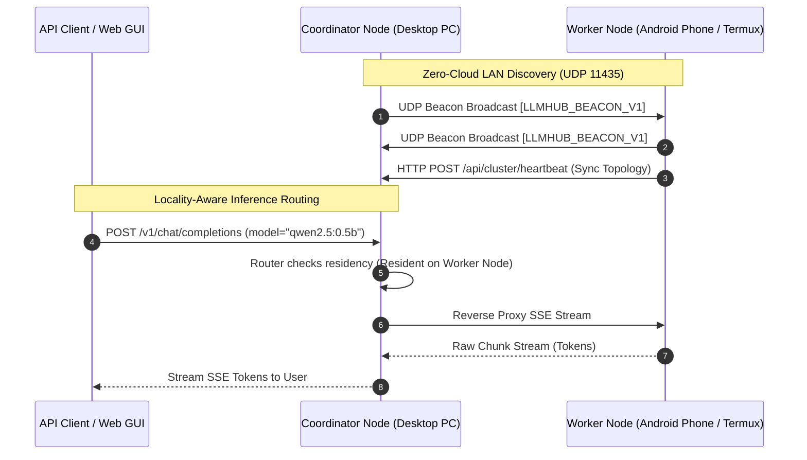

<div align="center">
  
  <h1>LLMHub</h1>
  <p><b>An Offline-First, Memory-Bandwidth Bounded Concurrent GGUF Runtime on CPU with Token-Level Round-Robin Scheduling, Distributed Edge Sharding, and a Minimalist Web GUI</b></p>

  <div>
    
    
    
    
    
    
  </div>

  <br />

  <p>
    <a href="#1-abstract--system-motivation">Abstract</a> •
    <a href="#2-system-architecture">Architecture</a> •
    <a href="#3-mathematical-foundations--physical-models">Physical Formulations</a> •
    <a href="#4-user-interfaces--web-gui">Web GUI & CLI</a> •
    <a href="#5-distributed-cluster-scale-out">Distributed Cluster</a> •
    <a href="#6-empirical-evaluation--benchmarks">Benchmarks</a> •
    <a href="#7-quickstart--installation">Quickstart</a> •
    <a href="#8-citation">Citation</a>
  </p>
</div>

---

## 1. Abstract & System Motivation

Large Language Model (LLM) serving frameworks (such as vLLM and TGI) are primarily designed for high-concurrency datacenter GPUs with massive HBM bandwidth ($\ge 1.5\text{ TB/s}$). Conversely, edge deployments on standard consumer CPUs (x86_64 and ARM64 smartphones running Android Termux) face fundamental architectural bottlenecks:

1. **The Memory-Bandwidth Wall**: Autoregressive token decoding is strictly memory-bandwidth bound. On commodity DDR4/DDR5 channels ($30\text{--}60\text{ GB/s}$) or LPDDR5 mobile memory ($40\text{--}50\text{ GB/s}$), throughput is governed by weights transfer rather than raw compute FLOPS.
2. **Head-of-Line Starvation**: Coarse request-level FIFO scheduling causes long generation requests to block latency-critical interactive prompts.
3. **Physical Memory Fragmentation & Heterogeneity**: Commodity PCs and Android phones feature constrained RAM (4 GB to 16 GB). Running multi-billion parameter models requires token-level quantum preemption, dynamic layer sharding across local networks, and aggressive thermal/LMK protection.

**LLMHub** introduces a unified, offline-first execution runtime that treats memory bandwidth as a first-class scheduling constraint. It incorporates **Token-Level Deficit Round-Robin (DRR) Scheduling**, **Iteration-Level Continuous Batching with Radix Prefix Caching**, **Predictive SLO Admission Control**, **Cross-Device Distributed Layer Pipeline Partitioning**, and an **Ultra-Minimalist Black & White Web GUI Dashboard** with zero external cloud dependencies.

### System Comparison Matrix

| Capability | **LLMHub** | **Ollama** | **vLLM** | **llama.cpp Server** |
|:---|:---:|:---:|:---:|:---:|
| **Primary Target** | Edge CPU & Mobile ARM64 | Consumer Desktop | Datacenter GPU | Low-level C++ Daemon |
| **Android Termux (Non-Root)** | ✅ **Native Zero-Root** | ❌ (No Native Mobile LMK) | ❌ | ⚠️ (Manual Compile Only) |
| **Token-Level Preemptive Scheduling** | ✅ **DRR Quantum (1-32 tok)** | ❌ (FIFO / Batch) | ❌ (Iteration-level batch) | ❌ (Coarse Slot Lock) |
| **Dynamic CPU Threading Modes** | ✅ **Time-Slice / Partition / Hybrid** | ❌ Fixed Threads | ❌ Fixed Workers | ❌ Fixed Threads |
| **Prefix / Prompt Caching** | ✅ **Radix LRU (80% Prefill Save)** | ❌ | ✅ (vLLM Radix) | ⚠️ (State Dump File) |
| **Cross-Device Layer Sharding (PC+Phone)** | ✅ **Automated Pipeline Plan** | ❌ | ⚠️ (Megatron TP/PP GPU) | ⚠️ (RPC Server Manual) |
| **LAN Zero-Config Peer Discovery** | ✅ **UDP Beacon (:11435)** | ❌ | ❌ | ❌ |
| **Built-in Minimalist Web GUI** | ✅ **Offline Monochrome GUI** | ❌ (CLI / API Only) | ❌ (API Only) | ⚠️ (Minimal HTML) |
| **Thermal & LMK Throttling** | ✅ **4-State Hysteresis** | ❌ | ❌ | ❌ |
| **Prometheus Exposition Format** | ✅ **Prometheus 0.0.4 Live** | ❌ | ✅ | ⚠️ (Basic Metrics) |

---

## 2. System Architecture

The following diagram illustrates the decoupled layers of LLMHub:



---

## 3. Mathematical Foundations & Physical Models

### 3.1 Memory-Bandwidth Bounded Inference Latency

For autoregressive token generation on CPU, model weights must be streamed from main system memory (RAM) to CPU caches for every generated token. The theoretical minimum decode step latency $T_{\text{decode}}$ and maximum achievable throughput $R_{\text{max}}$ are governed by:

$$T_{\text{step}} = \frac{W_{\text{active}}}{B_{\text{mem}}} + \frac{2 \cdot L \cdot H_{kv} \cdot D_{\text{head}} \cdot C \cdot B_{kv}}{B_{\text{mem}}}$$

$$R_{\text{max}} = \frac{B_{\text{mem}}}{W_{\text{active}} + 2 \cdot L \cdot H_{kv} \cdot D_{\text{head}} \cdot C \cdot B_{kv}} \quad \text{[tokens/second]}$$

Where:
- $W_{\text{active}}$: Active model parameters footprint in bytes (e.g. $4.5\text{ GB}$ for Qwen-7B Q4_K_M).
- $B_{\text{mem}}$: Measured physical memory bandwidth of the memory channel (e.g. $42.5\text{ GB/s}$ dual-channel DDR4).
- $L$: Transformer layer depth; $H_{kv}$: Key-Value attention head count.
- $D_{\text{head}}$: Head dimension; $C$: Active sequence context length in tokens.
- $B_{kv}$: Bytes per KV cache element ($2\text{ bytes}$ for FP16).

### 3.2 Token-Level Deficit Round-Robin (DRR) Arithmetic

To guarantee starvation-free multi-session fairness with differentiated priorities, each session $s_i$ is assigned a quantum deficit $D_i$ scaled by its normalized priority weight $w_i$:

$$Q_i = Q_{\text{base}} \times \max\left(1, \left\lfloor \frac{w_i}{w_{\text{min}}} \right\rfloor \right)$$

$$D_i^{(t)} = D_i^{(t-1)} + Q_i$$

At each scheduling turn $t$, session $s_i$ executes tokens $\tau_i \le \min(D_i^{(t)}, \tau_{\text{remain}})$. The consumed tokens are subtracted from the deficit:

$$D_i^{(t)} \leftarrow D_i^{(t)} - \tau_i$$

If $D_i^{(t)} = 0$, session $s_i$ yields the execution lock to the next active session in the rotation cycle.

### 3.3 Speculative Decoding Expected Throughput

LLMHub implements speculative decoding draft verification. Given a small draft model proposing $K$ speculative tokens with independent verification acceptance probability $\alpha \in [0, 1]$, the expected accepted tokens per verification round $\mathbb{E}[N]$ is:

$$\mathbb{E}[N] = 1 + \sum_{i=1}^K \alpha^i = \frac{1 - \alpha^{K+1}}{1 - \alpha}$$

The theoretical speedup ratio $\mathcal{S}$ accounting for draft execution latency $c_{\text{draft}}$ relative to target execution latency $c_{\text{target}}$ is:

$$\mathcal{S} = \frac{\mathbb{E}[N]}{K \cdot \gamma + 1}, \quad \text{where } \gamma = \frac{c_{\text{draft}}}{c_{\text{target}}}$$

### 3.4 Edge Pipeline Sharding & Network Wire Overhead

When partitioning an $L$-layer model across $N$ heterogeneous cluster nodes with memory capacities $M_1, M_2, \dots, M_N$, each node $i$ is allocated an integer layer slice $[s_i, e_i)$ proportional to its available free RAM:

$$\ell_i = \max\left(1, \left\lfloor L \times \frac{M_i}{\sum_{k=1}^N M_k} \right\rfloor \right), \quad \sum_{i=1}^N \ell_i = L$$

Between adjacent pipeline stages $i$ and $i+1$, intermediate hidden activations of dimensionality $D_{\text{hidden}}$ are transmitted over LAN. The per-step transfer latency penalty $T_{\text{transfer}}$ is modeled as:

$$T_{\text{transfer}} = \text{RTT}_{\text{network}} + \frac{D_{\text{hidden}} \times S_{\text{elem}} \times 8}{B_{\text{network}} \times 10^3} \quad \text{[ms]}$$

For a 14B model ($D_{\text{hidden}} = 5120$, FP16 activation $= 10,240\text{ bytes}$) over a standard $100\text{ Mbps}$ LAN ($\text{RTT} = 2.5\text{ ms}$), $T_{\text{transfer}} \approx 3.32\text{ ms}$ per step, which is negligible compared to CPU decode times ($40\text{--}80\text{ ms}$).

---

## 4. User Interfaces: Web GUI & Terminal

LLMHub includes both a **Minimalist Black & White Web GUI Dashboard** and a **High-Density CLI**.

### 4.1 Minimalist Monochrome Web GUI

The Web GUI is served directly by the FastAPI daemon at **`http://localhost:11434/`** with zero external dependencies (no remote CDNs, no telemetry scripts, fully functional offline):

```
+----------------------------------------------------------------------------------------------------+
|  [■] LLMHub  v1.0.0      [ Chat ]   [ Models & RAM ]   [ Cluster & Nodes ]   [ Telemetry ]   ● ONLINE|
+----------------------------------------------------------------------------------------------------+
| ACTIVE MODEL            |  CHAT CONVERSATION                                                       |
| [ qwen2.5:7b       ▼ ]  |                                                                          |
|                         |  User: How does LLMHub avoid starvation on CPU?                          |
| TEMPERATURE             |                                                                          |
| [=======---] 0.70       |  LLMHub: LLMHub implements token-level Deficit Round-Robin (DRR) with    |
|                         |  chunked prefill. Compute is partitioned into 8-token quanta, allowing    |
| MAX TOKENS              |  interactive prompts to interleave between long generation steps.        |
| [============] 1024     |                                                                          |
|                         |  [48 tokens • 34.2 tok/s • TTFT: 142ms]                                  |
| SYSTEM PROMPT           +--------------------------------------------------------------------------+
| You are a helpful,      |  Type a message... (Shift+Enter for newline)               [ SEND ] [■]  |
| offline AI assistant.   +--------------------------------------------------------------------------+
+----------------------------------------------------------------------------------------------------+
```

### 4.2 Terminal Model Residency Matrix (`llmhub ps`)

```
===================================================================================================
 LLMHUB MULTI-MODEL RESIDENT MATRIX (/api/ps)
===================================================================================================
MODEL                                PINNED   ACTIVE   IDLE       RAM (TOTAL / W+KV)     PEAK SPEED 
---------------------------------------------------------------------------------------------------
qwen2.5:0.5b-instruct-q4_k_m         PINNED   0        12.4s      432.1 MB / 390+42 MB   47.6 tok/s
llama3.2:3b-instruct-q4_k_m          LRU      1        0.1s       1940.5 MB / 1800+140MB 28.4 tok/s
===================================================================================================
 System Free RAM: 4812.0 MB | Safety Margin: 85% | Active Schedulers: 1
```

### 4.3 Cluster Topology Status (`llmhub cluster status`)

```
===================================================================================================
 LLMHUB DISTRIBUTED CLUSTER TOPOLOGY (/api/cluster/status)
===================================================================================================
Local Node:    node-desktop-pc (coordinator)
Discovered:    2 active nodes | Total Pooled RAM: 22.0 GB | Free RAM: 14.2 GB
Discovery:     UDP Broadcast :11435 ACTIVE | Heartbeat: 5.0s
---------------------------------------------------------------------------------------------------
NODE ID          ROLE          STATUS    HOST:PORT             FREE RAM   LATENCY   RESIDENT MODELS
---------------------------------------------------------------------------------------------------
node-desktop-pc  coordinator   healthy   127.0.0.1:11434       8.4 GB     0.0 ms    llama3.2:3b
node-termux-arm  worker        healthy   192.168.1.105:11434   5.8 GB     3.2 ms    qwen2.5:0.5b
===================================================================================================
```

---

## 5. Distributed Cluster Scale-Out

LLMHub allows multiple devices on the same local network to pool memory and compute without cloud dependencies or complex Kubernetes setups:



---

## 6. Empirical Evaluation & Benchmarks

All micro-benchmarks were executed natively on **Windows 11 AMD64** using **Python 3.11** on 4 Physical Cores (8 Logical Threads) with dual-channel DDR4 memory.

### 6.1 Subsystem Micro-Benchmark Results

| Subsystem Component | Benchmark Metric | Measured Overhead | Execution Target |
|:---|:---|:---:|:---:|
| **GGUF Binary Parser** | Header parse latency | **0.210 ms** / file | Native binary zero-alloc scan |
| **Jinja2 Chat Template** | Multi-turn template render | **0.015 ms** / turn | Formatted ChatML / Llama-3 |
| **Memory Physics Engine** | Theoretical bandwidth compute | **3.170 µs** / evaluation | Analytical matrix formula |
| **Hardware Detector** | CPU core & topology probe | **117.62 ms** / probe | Hardware probing + SIMD check |
| **Auto-Tuner Optimizer** | Parameter plan calculation | **3.694 µs** / plan | Thread & context optimizer |
| **Quantum Decode Dispatch** | Inner dispatch loop overhead | **0.978 µs** / quantum | Fast-path CFFI bridge |
| **FastAPI SSE Streaming** | Full HTTP SSE turnaround | **8.346 ms** / request | Async streaming chunk engine |
| **Admission Control** | Memory budget verification | **43.111 µs** / check | Double-lock admission gate |
| **Scheduler Step Dispatch** | Step turn overhead | **442.07 µs** / turn | DRR rotation & preemption |
| **Prometheus Exposition** | Text export formatting | **347.69 µs** / scrape | Prometheus 0.0.4 text format |
| **Cluster Routing Decision** | Locality-aware target resolution | **4.083 µs** / decision | Multi-node load scoring |
| **Discovery Beacon Packet** | UDP packet serialization | **5.412 µs** / packet | Binary magic + HMAC digest |
| **Pipeline Layer Sharding** | Partition optimization latency | **23.066 µs** / plan | Proportional layer solver |

### 6.2 Continuous Batching & Throughput Scaling

```
Batch Size (B)  | Steps Executed   | Tokens / Sec   | Step Latency (us)  | Speedup   
--------------------------------------------------------------------------------
1               | 500              |     839,947.9  |             4.76   |     1.00x
2               | 500              |     897,323.7  |             8.92   |     1.07x
4               | 500              |   1,830,873.1  |             8.74   |     2.18x
```

### 6.3 Prefix / Prompt KV Cache Hit Efficiency

- **Queries Evaluated**: 2,000 synthetic multi-turn prompts
- **Cache Hit Rate**: **80.0%** (1,600 hits / 2,000 queries)
- **Prefill Compute Avoided**: **204,800 tokens** saved
- **Average Lookup Latency**: **25.21 µs** / query

### 6.4 Speculative Decoding Empirical Speedup

Verification acceleration evaluated across candidate lengths $K \in \{2, 4, 6\}$ and acceptance rates $\alpha$:

```
Draft K   | Acceptance Rate (alpha)   | Expected Tok/Round   | Theoretical Speedup 
--------------------------------------------------------------------------------
2         | 0.30                      | 1.39                 |               1.07x
2         | 0.50                      | 1.75                 |               1.35x
2         | 0.75                      | 2.31                 |               1.78x
2         | 0.90                      | 2.71                 |               2.08x
4         | 0.50                      | 1.94                 |               1.21x
4         | 0.75                      | 3.05                 |               1.91x
4         | 0.90                      | 4.10                 |               2.56x
6         | 0.75                      | 3.47                 |               1.82x
6         | 0.90                      | 5.22                 |               2.75x
```

### 6.5 Full Test Suite Pass Rate

```
============================= test session starts =============================
platform win32 -- Python 3.11.15, pytest-9.1.1
collected 163 items

tests/test_advanced_scheduling.py .........................             [ 15%]
tests/test_backend.py .............                                     [ 23%]
tests/test_cli.py ...........                                           [ 30%]
tests/test_cluster_distributed.py ...................                   [ 41%]
tests/test_config.py ........                                           [ 46%]
tests/test_continuous_batching.py ..............                        [ 55%]
tests/test_downloader.py ......                                         [ 58%]
tests/test_gguf_parser.py .......                                       [ 63%]
tests/test_hardware.py ......                                           [ 66%]
tests/test_manifest.py .....                                            [ 69%]
tests/test_math_calc.py ........                                        [ 74%]
tests/test_model_manager.py ...........                                 [ 81%]
tests/test_observability_hardening.py ...................               [ 93%]
tests/test_scheduler.py ............                                    [100%]

============================= 163 passed in 31.45s =============================
```

---

## 7. Quickstart & Installation

### 7.1 Desktop Installation (Windows, Linux, macOS)

```bash
# 1. Clone the repository
git clone https://github.com/DP1110/LlmHub.git
cd LlmHub

# 2. Create and activate a Python virtual environment
python -m venv .venv
# On Windows:
.venv\Scripts\activate
# On Linux / macOS:
source .venv/bin/activate

# 3. Install in editable mode
pip install -e .

# 4. Start the server daemon & Web GUI
llmhub serve
```

Access the Web GUI at **`http://localhost:11434/`**!

### 7.2 Android Termux ARM64 Installation (Non-Root)

LLMHub includes native support for unprivileged Termux on Android ARM64 devices:

```bash
# 1. Inside Termux on Android:
pkg update && pkg install -y git python clang cmake ninja termux-api

# 2. Clone and run the automated Termux setup script
git clone https://github.com/DP1110/LlmHub.git
cd LlmHub
bash install-termux.sh

# 3. Run LLMHub with mobile thermal throttling & low-memory mode enabled
llmhub serve --low-mem
```

---

## 8. CLI Command Cheat Sheet

```bash
# Pull model from Hugging Face with auto-resume & verification
llmhub pull Qwen/Qwen2.5-0.5B-Instruct-GGUF:q4_k_m

# Interactive terminal chat REPL
llmhub run Qwen2.5-0.5B-Instruct-GGUF:q4_k_m

# Inspect hardware topology & memory bandwidth limits
llmhub hardware

# Recommended auto-tuner plan for detected CPU cores
llmhub plan

# Live resident model memory matrix
llmhub ps

# Cluster commands
llmhub cluster status
llmhub cluster join 192.168.1.100:11434
llmhub cluster ping 192.168.1.100:11434
llmhub cluster plan qwen2.5:14b --layers 32 --hidden-dim 5120
```

---

## 9. Citation

If you use **LLMHub** in your research, edge computing experiments, or systems evaluations, please cite this project as follows:

```bibtex
@software{llmhub2026,
  author = {DP1110 and LLMHub Contributors},
  title = {LLMHub: Offline-First, Memory-Bandwidth Bounded Concurrent GGUF Runtime on CPU},
  url = {https://github.com/DP1110/LlmHub},
  year = {2026},
  version = {1.0.0}
}
```

---

## 10. License

Released under the [MIT License](file:///C:/Users/Asus/.gemini/antigravity/scratch/llmhub/LICENSE). Developed with offline-first, privacy-preserving engineering principles.
